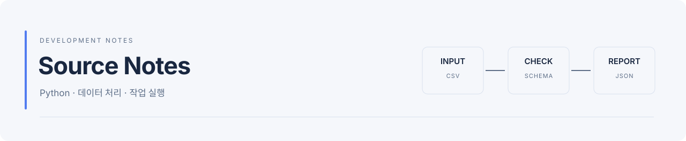

<picture>
  <source media="(prefers-color-scheme: dark)" srcset="assets/header-dark.svg">
  
</picture>

데이터 처리와 작업 실행 도구를 개발합니다.
동작이 불분명한 부분은 작은 코드로 확인하고, 재현 방법과 테스트를 기록합니다.

Python · TypeScript · Vue · Java · Spring · SQL

## 다루는 주제

| 분야 | 작업 내용 |
| --- | --- |
| 작업 처리 | 상태 전이, 취소·재시도, 프로세스 중단 후 복구 |
| 데이터 처리 | CSV 검증, 파일 읽기 비교, 시계열 학습·검증 구간 검사, 합성·실제 사진 중복 검사, 반전·회전 사본 검사 |
| DB·실행 | SQLite 트랜잭션, 작업 소유권, 도구 재호출과 중복 방지, PostgreSQL 목록 조회 계획과 동시 쓰기 중 조회 |
| Agent·LLM | 도구 실행 복구, 도구 호출 평가와 채점기, MCP 도구 서버 공격 시험과 HTTP 토큰 권한 시험, 재시도와 호출 예산, LLM 판정기 검사, 검색 평가, 임베딩·재정렬 비교, 구조화 출력 비교 |
| 학습·서빙 | 학습·검증 분할 검사, 그룹 분할과 전처리 누수, 그룹 K-겹 평가 오차와 적은 설비의 구간 보정, 작은 모델 양자화의 정확도·지연·메모리 비교, vLLM 서빙 처리량·스케줄러 설정·요청률별 지연 |
| 설계·검증 | 입력 계약, 설계 변경 회고와 점검표, 실행 예제와 테스트 근거 |

## 실험 기록

실험 조건과 결과, 재현 방법은 [engineering-lab](https://github.com/srcnote/engineering-lab)에 있습니다.

## 다음 작업

서빙 서버의 스케줄러 설정(한 단계 토큰 한도, 접두사 캐시)이 동시 요청이 몰릴 때의 대기와 첫 토큰 시간을 바꾸는지 확인할 예정입니다.
