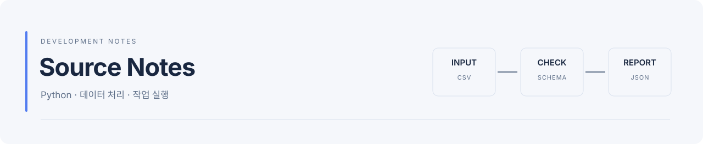

<picture>
  <source media="(prefers-color-scheme: dark)" srcset="assets/header-dark.svg">
  
</picture>

데이터 처리와 작업 실행 도구를 개발합니다.
동작이 불분명한 부분은 작은 코드로 확인하고, 재현 방법과 테스트를 기록합니다.

Python · TypeScript · Vue · Java · Spring · SQL

## 다루는 주제

| 분야 | 작업 내용 |
| --- | --- |
| 작업 처리 | 상태 전이, 취소·재시도, 프로세스 중단 후 복구 |
| 데이터 처리 | CSV 검증, 파일 읽기 비교, 시계열 학습·검증 구간 검사, 합성·실제 사진 중복 검사, 반전·회전 사본 검사 |
| DB·실행 | SQLite 트랜잭션, 작업 소유권, 도구 재호출과 중복 방지, PostgreSQL 목록 조회 계획과 동시 쓰기 중 조회 |
| Agent·LLM | 도구 실행 복구, 도구 호출 평가와 채점기, MCP 도구 서버 공격 시험과 HTTP 토큰 권한 시험, 재시도와 호출 예산, LLM 판정기 검사, 검색 평가, 임베딩·재정렬 비교, 구조화 출력 비교 |
| 학습·서빙 | 학습·검증 분할 검사, 그룹 분할과 전처리 누수, 그룹 K-겹 평가 오차, 작은 모델 양자화의 정확도·지연·메모리 비교, vLLM 서빙 처리량·스케줄러 설정·요청률별 지연 |
| 설계·검증 | 입력 계약, 설계 변경 회고와 점검표, 실행 예제와 테스트 근거 |

## 최근 작업

**작업 큐 연결 유지**

앞 실험에서 찾은 원인(연결을 닫을 때마다 일어나는 체크포인트)을 제품에 반영해, 오래 도는 워커와 화면이 DB 연결 하나를 유지하도록 바꿨습니다.
내구성 설정은 그대로 둔 채 커밋 시간이 약 9ms에서 3.5ms로 줄었고, 동시 실행 시험과 Windows에서도 문제가 없었습니다.

**작업 큐 synchronous 설정**

SQLite 작업 큐의 디스크 동기화 설정을 가볍게 바꾸면 얼마나 빨라지는지 쟀는데, 작업마다 연결을 닫는 구조에서는 전혀 빨라지지 않았습니다.
연결을 닫을 때의 WAL 체크포인트가 실제 비용이었고, 연결 하나를 열어 두면 같은 검사가 5.3초에서 0.46초로 줄었습니다. 앞 실험의 원인 설명도 바로잡았습니다.

**입력 사본 보관 정책**

CSV 검사 도구에 끝난 작업의 입력 사본을 정리하는 명령을 넣고, 등록·실행·재시도와 정리를 동시에 돌려 지우면 안 되는 파일을 지우지 않는지 시험했습니다.
시험 중 등록 중인 사본을 버려진 파일로 지우는 틈을 찾아 고쳤고, 고친 뒤에는 세 번의 동시 실행에서 잘못 지운 사본이 없었습니다.

**Dataset Checker 열 간 조건 검사**

CSV 검사 도구에 시각 형식과 열 사이 규칙(시작은 종료보다 앞, 함께 채워져야 하는 열)을 넣고, 오류를 심은 10만 행에서 정확도와 속도를 쟀습니다.
심은 오류 914개를 모두 찾았고, 구현 중 기능을 쓰지 않는 기존 검사가 7~8% 느려진 것을 바꾸기 전 코드와 번갈아 재서 찾아 고쳤습니다.

**Dataset Checker 체크포인트 저장 기준**

앞 실험 결과를 제품에 반영해, CSV 검사 워커가 행 수만이 아니라 마지막 저장 뒤 경과 시간도 보고 체크포인트를 저장하도록 바꿨습니다.
같은 20만 행 입력의 검사가 3.16초에서 0.49초로 빨라졌고, 기존 테스트와 최종 검사 결과는 그대로였습니다.

**CSV 워커 체크포인트 간격**

CSV 검사 워커가 체크포인트를 몇 행마다 저장할지에 따라 저장 비용, 취소 반영, 멈춘 뒤 다시 검사하는 양을 쟀습니다.
기본 1,000행 간격에서는 저장이 실행 시간의 81%였고(원인은 이후 실험에서 연결을 닫을 때의 체크포인트로 확인), 간격을 늘려도 취소는 0.22초 안에 확정됐습니다.

**SSE 이벤트 기록 영속화**

작업 진행 이벤트를 SQLite에 남기고 API가 읽어 보내는 구성에서, API 프로세스를 강제로 세 번 재시작해도 화면이 이어서 받는지 쟀습니다.
SQLite 기록과 `Last-Event-ID`를 함께 쓰면 놓친 이벤트가 0이었고, API 메모리에만 두면 재시작 동안의 이벤트가 오류 없이 사라졌습니다.

**진행률 전송: 폴링과 SSE**

긴 작업의 진행률을 폴링과 SSE로 보낼 때, 연결이 끊겼다 다시 붙으면 무엇을 놓치는지 같은 고장 일정으로 비교했습니다.
1초 폴링은 짧은 단계 변화를 매번 놓쳤고, 번호 없이 다시 연결한 SSE는 끊김 동안의 이벤트를 빠뜨렸으며, `Last-Event-ID`로 이어 받으면 하나도 놓치지 않았습니다.

**설비 단위 부트스트랩 구간**

평가 방법의 신뢰 구간이 실제 새 설비 정확도를 95% 가까이 맞히는지, 기준값을 새 설비 1,000대로 정확히 잡아 다시 쟀습니다.
평가 설비가 30대면 89~96%로 명목값에 가까웠지만, 12대에서는 어떤 구간도 89%를 넘지 못했습니다.

**그룹 K-겹 반복 평가**

새 설비에 쓸 모델을 설비 단위로 한 번 나눠 평가할 때와 그룹 K-겹·반복 분할로 평가할 때, 새 설비 정확도를 얼마나 정확히 맞히는지 비교했습니다.
그룹 5-겹은 한 번 분할보다 오차가 32~51% 작았습니다. 겹별 흔들림으로 만든 구간은 반복 분할과 설비가 적은 경우 실제 정확도를 95%보다 적게 포함했습니다.

**정해진 시각에 요청을 보내는 서빙 부하**

요청을 앞 요청과 상관없이 정해진 시각에 보내며 요청률을 올려, 첫 토큰 시간이 어디서부터 늘어나는지 쟀습니다.
접두사 캐시를 끈 서버는 초당 8개부터 대기열이 계속 쌓였고, 켠 서버는 초당 16개까지 첫 토큰 p95가 0.1초 아래였습니다.

**서빙 서버의 스케줄러 설정**

동시 요청 64에서 첫 토큰이 늦어진 원인을 찾으려고, 같은 서버의 한 단계 토큰 한도와 접두사 캐시만 바꿔 쟀습니다.
토큰 한도를 8배로 올려도 대기는 그대로였고, 공통 지시문을 재사용하는 접두사 캐시를 켜자 대기가 없어지고 처리량이 2.2배가 됐습니다.

**양자화 모델의 서빙 서버 처리량**

같은 4B 모델을 vLLM 서버에 bf16·FP8·4bit로 올려 동시 요청 수별 처리량과 첫 토큰 시간, 정확도를 쟀습니다.
양자화는 요청이 적을 때 1.5배 이상 빨랐지만 동시 요청 64에서는 bf16보다 느렸고, 배치 생성으로 잰 이전 결과와 속도 순위가 달랐습니다.

**반전·회전에 강한 중복 검사**

비교할 사진을 반전·회전한 해시도 함께 비교해, 이전에 놓친 반전·회전 사본을 모두 찾는지 확인했습니다.
찾기는 했지만 둥근 안저 사진처럼 원래 대칭인 사진이 있으면 서로 다른 영역이 중복처럼 가까워져, 재압축한 사본을 더 놓쳤습니다.

**실제 사진의 중복 검사**

퍼블릭 도메인 사진으로 JPEG 재압축, 잘라내기, 좌우 반전 같은 실제 변형을 만들어 해시 방법별 중복 검출을 비교했습니다.
합성 이미지에서 정한 거리 기준이 실제 사진에는 맞지 않는다는 것을 확인했고, 잘라낸 사본은 pHash가 가장 잘 찾았습니다.

**MCP 서버의 HTTP 전송과 요청별 권한**

도구 서버를 HTTP로 띄우고 토큰 종류에 따라 인증 응답, 권한별 도구 목록과 호출 거부, 요청 출처 검사가 동작하는지 시험했습니다.
인증을 끈 같은 서버를 대조군으로 두어 시험이 차이를 잡는지 확인했고, 거부된 요청의 토큰이 접근 로그에 남는 문제를 찾았습니다.

**그룹 분할과 전처리 적합 범위**

설비마다 데이터가 다를 때, 분할 방식과 전처리를 맞추는 범위에 따라 평가 점수가 새 설비 성능보다 얼마나 부풀려지는지 쟀습니다.
설비 단위 분할이 새 설비 성능에 가장 가까웠고, 표준화 범위는 영향이 거의 없었지만 라벨을 쓰는 인코딩은 점수를 크게 부풀렸습니다.

**오류 종류별 재시도와 호출 예산**

도구 호출 오류를 일시적인 것과 영구적인 것으로 나눠 재시도하는 전략을 시뮬레이션으로 비교했습니다. 응답을 못 받은 생성 요청을 다시 보낼 때의 중복도 함께 쟀습니다.
이전 Agent 평가에서 작은 모델이 스스로 다시 시도하지 않아 실패한 경우에 실행 계층 재시도를 붙였고, 같은 시나리오가 통과하는 것을 확인했습니다.

**PostgreSQL 동시 변경 중 목록 조회**

한 연결이 목록을 끝까지 넘기는 동안 다른 연결이 실제로 행을 추가하거나 상태를 바꾸게 하고, 페이지 방식과 트랜잭션 격리 수준별로 누락·중복을 쟀습니다.
페이지마다 따로 읽는 OFFSET에서만 누락·중복이 생겼고, 커서나 트랜잭션 하나로 읽는 방식은 막았습니다. 대신 트랜잭션 하나로 읽으면 도중에 바뀐 상태를 반영하지 못했습니다.

**학습·검증 이미지 중복 검사**

이름만 바꾸거나 밝기·크기·잡음을 바꾼 같은 이미지를 학습·검증 사이에서 찾는 방법을 비교했습니다.
파일 이름, 파일 해시, 픽셀 해시, 지각 해시 두 가지의 변형별 검출률과 서로 다른 이미지를 잘못 잡는 수를 함께 쟀습니다.
표준 라이브러리만으로 만들고 합성 이미지로 측정했습니다.

**RAG 답변의 LLM 판정기 검사**

정답 판정을 아는 답변 문항을 만들어, 로컬 모델 네 개로 돌린 LLM 판정기의 정확도와 일관성을 쟀습니다.
판정기마다 놓치는 답변 종류가 달랐고, 근거 문서 순서만 바꿔도 판정이 바뀌는 문항이 있었습니다.
카나리아 문항이 망가진 판정기는 걸러내지만 좋은 판정기를 고르기에는 부족하다는 점도 확인했습니다.
사람이 판정한 22문항과 비교하면 가장 큰 판정기가 18문항에서 일치했고, 판정기 여러 개의 다수결은 그보다 낫지 않았습니다.

**MCP 도구 서버 공격 시험**

공식 MCP SDK로 도구 서버를 만들고, 기본 타입 검증만 둔 구성과 경로·값·권한 검사를 더한 구성에 같은 공격 시험을 보냈습니다.
기본 구성은 경로 조작으로 폴더 밖 파일을 읽고 권한 밖 쓰기를 처리했지만, 검사를 더한 구성은 모두 막았습니다.
SDK가 명세와 다르게 응답하는 부분은 SDK 소스에서 위치를 확인해 기록했습니다.

**작은 모델 양자화**

같은 모델을 bf16, INT8, 4bit로 올려 구조화 출력 과제의 정확도, 지연, GPU 메모리, 배치별 처리량을 비교했습니다.
bf16 결과가 이전 실험과 글자까지 같게 재현되는 것을 먼저 확인해, 정밀도에 따른 차이를 실행 편차와 구분했습니다.
큰 모델을 4bit로 올리는 쪽이 작은 모델 bf16보다 메모리를 덜 쓰면서 정확도가 높았습니다.

**Agent 도구 호출 평가**

가짜 설비 도구와 시나리오 10개로 도구 실패, 잘못된 인자, 금지된 도구 호출, 재조회가 필요한 상황을 재현했습니다.
채점기를 정답을 아는 실패 기록으로 먼저 검증한 뒤 로컬 모델 세 개를 연결해 실패 종류를 비교했습니다.
도구 설명의 예시 값을 모델이 그대로 따라 쓰는 문제와, 일시 오류 뒤 다시 시도하지 않는 경향을 확인했습니다.

**LLM 구조화 출력**

로컬 GPU에서 크기가 다른 공개 모델 세 개로 자유 생성, 오류를 알려 주는 재시도, 문법으로 형식을 강제하는 방식을 비교했습니다.
형식 오류와 내용 오류를 나눠 세고, 가장 작은 모델에서 형식 강제가 정확도를 낮춘 원인을 추가 조건으로 다시 실행해 좁혔습니다.
합성 점검 기록으로 측정했으며 외부 API는 사용하지 않았습니다.

**임베딩 검색과 재정렬**

공개 한국어 검색 평가셋에서 BM25, 임베딩 모델 3종, 순위 결합, 교차 인코더 재정렬을 GPU로 비교했습니다.
품질(nDCG·Recall)과 함께 질문당 지연과 GPU 메모리를 기록했고, 같은 순위를 외부 평가 도구로 다시 계산해 대조했습니다.
구현 전에 설계와 예상 위험을 적고, 끝난 뒤 실제로 바뀐 부분과 비교했습니다.

**설계 변경 회고**

지금까지의 커밋에서 처음 구현 뒤 다시 바꾼 사례를 모아 원인별로 나눴습니다.
여기서 구현 전에 답할 질문을 점검표로 만들고 새 실험의 설계에 적용하고 있습니다.

**DB 목록 조회**

조회 중 행이 추가되거나 빠질 때 OFFSET과 커서 조회의 누락·중복을 비교했습니다.
PostgreSQL에서 인덱스 구성별로 깊은 페이지의 실행 계획·읽은 블록·시간을 측정했습니다.
합성 데이터의 결과이며 실제 동시 트랜잭션과 콜드 캐시 조건은 다음에 확인합니다.

**문서 검색 평가**

고정 질문·정답 문서로 BM25·문자 TF-IDF·순위 결합을 비교했습니다.
Recall·MRR과 정답 없는 질문의 문서 반환을 나눠 기록하고, 다른 검색 결과도 평가할 수 있는 CLI를 만들었습니다.
입력 계약의 설계 결정과 검증 항목을 코드·실행 예제에 연결했습니다. 모델 응답 품질은 별도 평가 대상입니다.

**Agent 도구 재호출**

작업 등록 후 응답 전에 프로세스가 중단되는 상황을 재현했습니다.
작업 생성과 호출 결과를 나눠 저장할 때의 중복과 같은 트랜잭션으로 확정할 때의 동작을 비교했습니다.
실제 모델 호출 없이 실행 계층을 검증한 실험입니다.

**시계열 학습·검증 분할**

무작위·시간순·경계 제거 분할에서 원본 샘플이 양쪽에 들어가는지 비교했습니다.
합성 구간으로 경계 조건과 짧은 원본의 제외량을 확인하고, 실제 분할 목록을 검사하는 CLI를 만들었습니다.
모델 성능을 측정한 결과와 구간 겹침 검사 결과는 구분해 기록합니다.

**백그라운드 작업 복구**

체크포인트와 실행 소유권을 저장해 워커 중단 후 작업을 이어갑니다.
취소와 완료의 경합, 이전 워커의 늦은 갱신, 서버 전체 재시작을 테스트했습니다.

**CSV 읽기 비교**

전체 로딩과 행 단위 집계를 같은 입력으로 비교했습니다.
행 수별 시간과 Python 추적 할당량을 측정하고, 두 방식의 집계값이 일치하는지 확인했습니다.

**Dataset Checker**

CSV의 열·형식·빈 값·범위를 검사하는 CLI입니다. 검사를 큐에 등록해 워커로 실행하고,
체크포인트에서 복구할 수 있습니다. 작업 조회 화면에서 검사 수·오류·이력을 확인하고
취소·재시도와 완료 보고서 다운로드를 할 수 있습니다.

## 다음 작업

서빙 서버의 스케줄러 설정(한 단계 토큰 한도, 접두사 캐시)이 동시 요청이 몰릴 때의 대기와 첫 토큰 시간을 바꾸는지 확인할 예정입니다.
